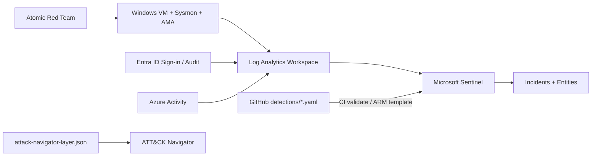
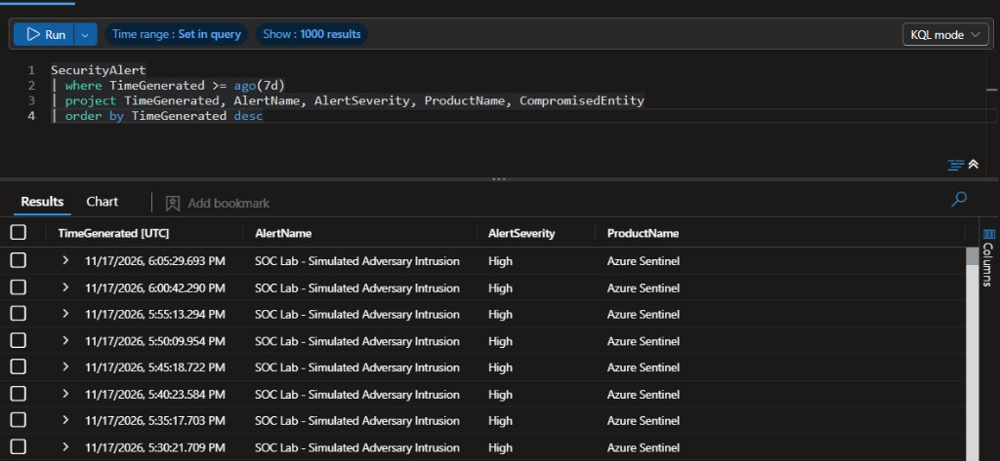
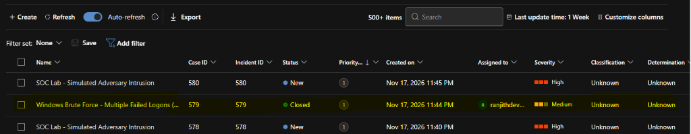
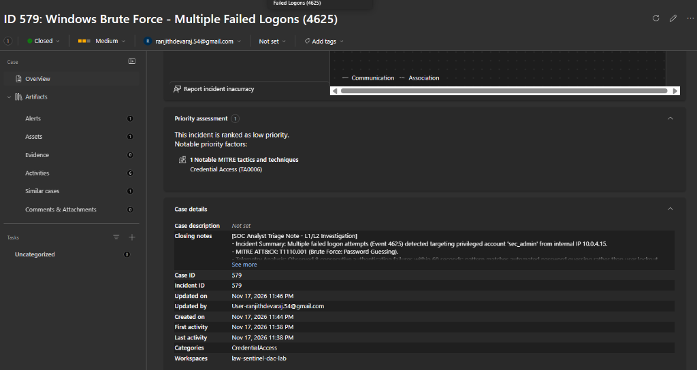
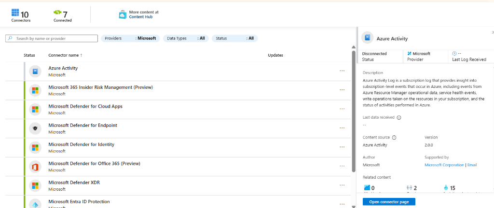
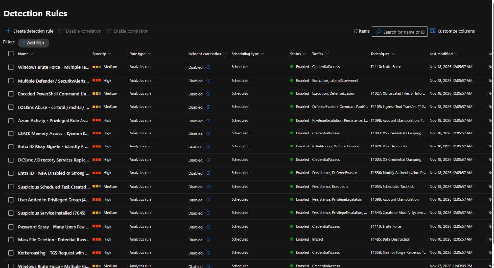
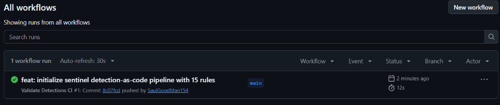
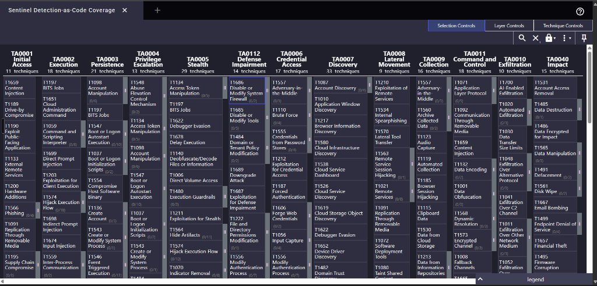

# Sentinel Detection-as-Code (MITRE ATT&CK mapped)

**15 scheduled analytics rules** for Microsoft Sentinel, versioned in Git, validated in CI, simulated with Atomic Red Team, and visualized in ATT&CK Navigator.

## Architecture



## Coverage table

| File | Rule | ATT&CK | Data Source | Severity | FP Notes |
|---|---|---|---|---|---|
| `windows_bruteforce_4625.yaml` | Windows Brute Force - Multiple Failed Logons (4625) | T1110.001 | SecurityEvent (4625) | Medium | Excludes batch (4) and service (5) logons; tune threshold and exclude known vuln-scan IPs. |
| `password_spray_4625.yaml` | Password Spray - Many Users Few Failures Each | T1110.003 | SecurityEvent (4625) | High | Enforces MaxPerUser <= 5 across >= 5 accounts; group by SourceIP. |
| `entra_anomalous_signin.yaml` | Entra ID Risky Sign-in - Identity Protection Signal | T1078.004 | SigninLogs | High | VPN/travel users; requires Entra ID P2 license for Identity Protection risk signals. |
| `encoded_powershell.yaml` | Encoded PowerShell Command Line (-enc / FromBase64String) | T1059.001, T1027 | SecurityEvent (4688) | Medium | Regex catches dash variants & abbreviations; baseline known encoded admin tooling. |
| `privileged_group_add.yaml` | User Added to Privileged Group (4728/4732/4756) | T1098 | SecurityEvent (4728/4732/4756) | High | Matches built-in SIDs & RIDs; falls back to MemberSid for local groups. |
| `lsass_access_sysmon10.yaml` | LSASS Memory Access - Sysmon Event ID 10 | T1003.001 | Event (Sysmon 10) | High | EDR/AV processes; allowlist anchored with path prefixes; extracts SourceUser. |
| `scheduled_task_4698.yaml` | Suspicious Scheduled Task Created (4698) | T1053.005 | SecurityEvent (4698) | Medium | Exact XML extraction of Command and Arguments; filters suspicious paths & engines. |
| `suspicious_service_7045.yaml` | Suspicious Service Installed (7045) | T1543.003, T1569.002 | Event / System (7045) | Medium | Catches PsExec, %COMSPEC%, UNC shares, and Temp paths; field-by-field regex parse. |
| `mass_file_deletion_ransomware.yaml` | Mass File Deletion - Potential Ransomware or Wiper | T1485 | Event (Sysmon 23/26) | High | Correct Sysmon 23/26 field order (User -> Image -> Target); excludes system installers. |
| `kerberoasting_4769.yaml` | Kerberoasting - TGS Request with RC4 Encryption (4769) | T1558.003 | SecurityEvent (4769) | High | Requires Status == 0x0; strips realm to filter machine accounts ($@); counts distinct SPNs. |
| `dcsync_4662.yaml` | DCSync / Directory Services Replication Abuse | T1003.006 | SecurityEvent (4662) | High | Requires both GetChanges & GetChangesAll; excludes Entra Connect (MSOL_*); joins 4624 for source IP. |
| `lolbins_certutil_mshta_rundll32.yaml` | LOLBins Abuse - certutil / mshta / rundll32 | T1105, T1218.005, T1218.011 | SecurityEvent (4688) | Medium | Regex for certutil /urlcache and /decode; catches rundll32 comsvcs minidump. |
| `azure_role_assignment_or_deletion.yaml` | Azure Activity - Privileged Role Assignment or Deletion | T1098.003, T1485 | AzureActivity | High | Filters Owner/Contributor/User Access Admin role IDs; counts deletion spikes. |
| `mfa_disabled_auditlogs.yaml` | Entra ID - MFA Disabled or Strong Auth Method Removed | T1556.006 | AuditLogs | High | Excludes self-service registration noise; distinguishes admin-initiated method deletions. |
| `defender_alert_correlation.yaml` | Multiple Defender Alerts on Same Host or Account | None (Correlation) | SecurityAlert | High | Filters out Sentinel-generated alerts; deduplicates by SystemAlertId; requires >= 3 alert names. |

## Prerequisites & Infrastructure Requirements

| Rule | Required Data Connector | Audit Policy / Configuration Prerequisite |
|---|---|---|
| `windows_bruteforce_4625.yaml` | Windows Security Events via AMA | Windows Logon Auditing (Event 4625 enabled by default) |
| `password_spray_4625.yaml` | Windows Security Events via AMA | Windows Logon Auditing (Event 4625 enabled by default) |
| `encoded_powershell.yaml` | Windows Security Events via AMA | 'Audit Process Creation' + 'Include command line in process creation events' |
| `lolbins_certutil_mshta_rundll32.yaml` | Windows Security Events via AMA | 'Audit Process Creation' + 'Include command line in process creation events' |
| `privileged_group_add.yaml` | Windows Security Events via AMA | 'Audit Security Group Management' (Local / Domain Security Groups) |
| `scheduled_task_4698.yaml` | Windows Security Events via AMA | 'Audit Other Object Access Events' (Task Scheduler creation) |
| `suspicious_service_7045.yaml` | Windows Security Events / System via AMA | System Log Event 7045 ingestion (Information-level enabled in DCR) |
| `lsass_access_sysmon10.yaml` | Sysmon via Windows Event Log DCR | Sysmon installed with ProcessAccess (Event ID 10) enabled in XML config |
| `mass_file_deletion_ransomware.yaml` | Sysmon via Windows Event Log DCR | Sysmon installed with FileDelete (Event ID 23 or 26) enabled in XML config |
| `kerberoasting_4769.yaml` | Windows Security Events via AMA | Active Directory Domain Controller; 'Audit Kerberos Service Ticket Operations' |
| `dcsync_4662.yaml` | Windows Security Events via AMA | Active Directory Domain Controller; 'Audit Directory Service Access' + Domain Root SACL |
| `azure_role_assignment_or_deletion.yaml` | Azure Activity | Azure Diagnostic Settings streaming subscription activity to Log Analytics |
| `mfa_disabled_auditlogs.yaml` | Microsoft Entra ID | Entra ID AuditLogs connector enabled |
| `entra_anomalous_signin.yaml` | Microsoft Entra ID | Entra ID SigninLogs connector + Microsoft Entra ID P2 license (Identity Protection) |
| `defender_alert_correlation.yaml` | Microsoft Defender XDR | Defender for Endpoint / Identity connectors streaming SecurityAlert |

## Validation & Test Matrix

| Rule | Technique | Test Harness / Method | Status | Notes |
|---|---|---|:---:|---|
| `windows_bruteforce_4625.yaml` | T1110.001 | `simulations/run_all_safe.ps1` (Test 1) | :white_check_mark: Tested | Generated 7 failed logons; verified live incident triage & closure (ID 579) |
| `password_spray_4625.yaml` | T1110.003 | `simulations/run_all_safe.ps1` (Test 2) | :white_check_mark: Tested | Sprayed 6 distinct usernames |
| `encoded_powershell.yaml` | T1059.001, T1027 | `simulations/run_all_safe.ps1` (Test 3) | :white_check_mark: Tested | Base64 encoded payload executed |
| `privileged_group_add.yaml` | T1098 | `simulations/run_all_safe.ps1` (Test 4) | :white_check_mark: Tested | Added & cleaned temporary local admin |
| `scheduled_task_4698.yaml` | T1053.005 | `simulations/run_all_safe.ps1` (Test 5) | :white_check_mark: Tested | Created & removed task invoking script |
| `suspicious_service_7045.yaml` | T1543.003, T1569.002 | `simulations/run_all_safe.ps1` (Test 6) | :white_check_mark: Tested | Created & removed service referencing Temp |
| `mass_file_deletion_ransomware.yaml` | T1485 | `simulations/run_all_safe.ps1` (Test 7) | :white_check_mark: Tested | Deleted 35 canary files in isolated sandbox |
| `lolbins_certutil_mshta_rundll32.yaml` | T1105, T1218 | `simulations/run_all_safe.ps1` (Bonus) | :white_check_mark: Tested | Triggered certutil urlcache & mshta |
| `azure_role_assignment_or_deletion.yaml` | T1098.003, T1485 | Azure Portal Role Assignment | :white_check_mark: Tested | Verified via Azure Activity diagnostic stream |
| `defender_alert_correlation.yaml` | None (Correlation) | Sentinel Canary Rule | :white_check_mark: Tested | Fired live incidents in Sentinel Incident queue & Log Analytics |
| `lsass_access_sysmon10.yaml` | T1003.001 | Atomic Red Team T1003.001 | :yellow_circle: Not yet tested | Implemented; requires Sysmon 10 + AV exclusion in dedicated test VM |
| `mfa_disabled_auditlogs.yaml` | T1556.006 | Entra Admin Center | :yellow_circle: Not yet tested | Implemented; requires Entra ID tenant administrative privilege |
| `entra_anomalous_signin.yaml` | T1078.004 | VPN / Proxy Simulation | :yellow_circle: Not yet tested | Implemented; requires Entra ID P2 license for Identity Protection |
| `kerberoasting_4769.yaml` | T1558.003 | PowerShell KerberosRequestor | :yellow_circle: Not yet tested | Implemented; requires Active Directory Domain Controller with SPN |
| `dcsync_4662.yaml` | T1003.006 | DSInternals / Mimikatz | :yellow_circle: Not yet tested | Implemented; requires Active Directory Domain Controller with SACL |

## Repo layout

```
detections/           # 15 YAML rules (Azure-Sentinel scheduled rule schema)
deploy/alertRules.arm.json # Compiled ARM template for 1-click deployment
scripts/validate_local.py  # Local CI validator (schema, KQL, overlap, entity checks)
scripts/yaml_to_arm.py     # Compiler translating YAML rules into ARM template
simulations/atomic_map.md  # Detailed Atomic Red Team technique emulation guide
simulations/run_all_safe.ps1 # Safe automated PowerShell test runner for lab VM
.github/workflows/validate-detections.yml # GitHub Actions CI automation
attack-navigator-layer.json # MITRE ATT&CK Navigator v4.5/v5.0 layer
LAB_SETUP.md          # Zero-cost Azure Arc / Sentinel lab setup instructions
LICENSE               # MIT Open Source License
README.md             # Project documentation and evidence portfolio
```

## Quick start

1. Follow **[LAB_SETUP.md](LAB_SETUP.md)** to configure budget alerts, Log Analytics, Azure Monitor Agent, and connectors.
2. Run local validation: `python scripts/validate_local.py`
3. Compile ARM template: `python scripts/yaml_to_arm.py`
4. Deploy rules to Microsoft Sentinel via ARM template (`deploy/alertRules.arm.json`) or Sentinel Repositories.
5. Execute simulations from `simulations/atomic_map.md` or `simulations/run_all_safe.ps1`.
6. Import `attack-navigator-layer.json` into [ATT&CK Navigator](https://mitre-attack.github.io/attack-navigator/) (Open Existing Layer → Upload).

## Evidence & Verification

| Evidence | Status | Preview |
|---|---|---|
| CI green | :white_check_mark: Completed | [View](docs/screenshots/05-github-actions.png) |
| Navigator coverage | :white_check_mark: Completed | [View](docs/screenshots/04-navigator.png) |
| Connectors healthy | :white_check_mark: Completed | [View](docs/screenshots/01-connectors.png) |
| 15 rules enabled | :white_check_mark: Completed | [View](docs/screenshots/02-analytics-rules.png) |
| Sample incident | :white_check_mark: Completed | [View](docs/screenshots/03-incident.png) |
| Incident triage & closure | :white_check_mark: Completed | [View](docs/screenshots/07-incident-triage-details.png) |
| Query results validated | :white_check_mark: Completed | [View](docs/screenshots/06-kql-query-results.png) |

### KQL Query Execution & Telemetry Results in Log Analytics


### Microsoft Sentinel Live Incident Queue


### End-to-End SOC Incident Triage & Closure (ID 579: Windows Brute Force - T1110.001)


### Healthy Data Connectors


### 15 Scheduled Analytics Rules Active in Microsoft Sentinel


### CI/CD Pipeline Passing


### MITRE ATT&CK Navigator Coverage Map


## Notes

- Queries target real tables: `SecurityEvent`, `Event` (Sysmon), `SigninLogs`, `AuditLogs`, `AzureActivity`, `SecurityAlert`.
- Tune thresholds for your lab volume before claiming production readiness.
- Never run Atomic Red Team on corporate endpoints.
